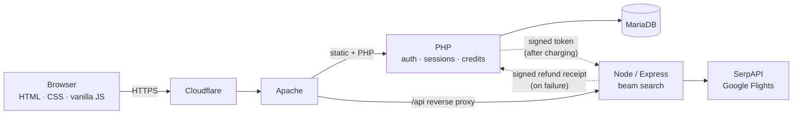

# PISTA

**Multi-city flight search that finds the cheapest order to visit several places.**
Live at **[pistaflights.com](https://pistaflights.com)**.


Flight search is built around "A to B". If you want to see four cities in sixteen days and don't
mind the order, you're left cross-referencing dozens of tabs. PISTA inverts that: give it a start
airport, a date, how many places you want to visit and how long to stay in each, and a beam search
explores the possible routes and returns the cheapest complete round trips. Constraints are optional:
must-visit cities, countries to avoid, a region to stay in.

It is a portfolio project. It takes no payments and issues no tickets — each leg hands off to
Aviasales to book.

---

## What's worth reading

| | Where |
|---|---|
| **Stratified beam pruning.** Keeping only the *k* cheapest partial routes systematically kills routes that satisfy must-visit constraints, because detours cost more before they pay off. One beam slot is reserved for the candidate fulfilling the most constraints. | [`pista-api/main.js`](pista-api/main.js), [`docs/ALGORITHM.md`](docs/ALGORITHM.md) |
| **A call-budget predictor — and where it stops holding.** Every price lookup is a paid API call, so the beam width is computed *before* searching to fit a budget. It turned out the guarantee only holds for some input shapes; a harness that drives the real search with stubbed APIs measured the true worst case (58 calls) and matched a closed-form formula across all 130 input combinations. Searches are now priced by that worst case instead of claiming a ceiling that wasn't there. | [`pista-api/tools/callBudget.js`](pista-api/tools/callBudget.js), [`webroot/search_cost.php`](webroot/search_cost.php) |
| **An HMAC handshake between two backends.** PHP charges credits; Node spends the money. A single-use, 120-second signed token binds the two, with a replay cache, scope checks and secret rotation — and the reverse direction (Node-signed refund receipts) for searches that fail. | [`pista-api/apiToken.js`](pista-api/apiToken.js), [`webroot/api_token.php`](webroot/api_token.php), [`webroot/refund.php`](webroot/refund.php) |
| **Security work found by reproducing it first.** A forgeable guest quota, a race that charged six searches for the price of one, a reset link built from a client-controlled header — each demonstrated, then fixed in layers, then re-tested. | [`docs/SECURITY.md`](docs/SECURITY.md) |
| **A search-quality harness written before the fix.** It reproduced a duplicate-itinerary bug in the beam search with zero API calls and was shown failing on five checks against the unfixed code. | [`pista-api/tools/searchQuality.js`](pista-api/tools/searchQuality.js) |

Both harnesses run offline, with no API key and no database:

```bash
cd pista-api
node tools/callBudget.js        # measured call counts vs the closed-form worst case
node tools/searchQuality.js     # beam-search invariants
```

---

## Architecture



- **PHP owns identity and data; Node owns routing and every outbound flight-API call.** Node never
  connects to the database, so the two meet only through signed messages.
- **Neither Node nor the database is reachable from the internet**, and web traffic reaches the
  origin only through Cloudflare.
- More in [`docs/ARCHITECTURE.md`](docs/ARCHITECTURE.md).

| Path | What |
|---|---|
| `webroot/` | Everything Apache serves: pages, page scripts, the PHP endpoints |
| `pista-api/` | The Node routing engine, airport data, and the two offline harnesses in `tools/` |
| `deploy/` | Reference copies of the database schema, Apache hardening, and the cron scripts |

**Stack:** PHP 8.3, MariaDB, Node 24 / Express, Apache, Cloudflare, Oracle Cloud. Frontend is plain
HTML/CSS/JS with Material Web Components and Leaflet — no build step. English, Spanish and Catalan.

---

## How this was built

I designed the system and directed the work, and I used **Claude Code** (an AI coding assistant)
as a pair programmer. Every commit in this repository's history after the baseline was made with it,
and says so in a `Co-Authored-By` trailer. How that works matters more than the tool:

- **Plan before code.** Anything touching more than one file, or an endpoint's contract, starts as a
  written plan covering cost, schema changes and cross-stack impact.
- **Reproduce before fixing.** Security issues and bugs are demonstrated first, so the fix can be
  shown to close them.
- **Every change ends with evidence**: syntax checks, then repository-wide invariant checks, then
  ordered functional tests.
- **Rules that broke twice became automated checks** — for example, that sessions and cookies are
  only ever touched in one file, that the PHP and JS price calculations agree on every input, and
  that no page ships without its translations. The assistant's configuration and those checks live
  in the private repository.

---

## What isn't here, and why

- **Most of the commit history.** The private repository has about 200 commits going back to March 2026.
  Its early commits contained credentials — all since rotated — so it can't be published or
  filtered safely. This repo's history starts at a baseline on 15 September 2026; every commit after
  it is **replayed** from the private one (original message and date, `Private-Commit:` trailer)
  through an allowlist and a scanning gate that checks every file and message against both secret
  patterns and every value ever committed as a secret. [`CHANGELOG.md`](CHANGELOG.md) covers what
  came before.
- **The operations runbook.** Code comments cite `docs/RUNBOOK.md`; it stays private because it is
  about the server rather than the software. The design decisions it records are summarised in
  [`docs/`](docs/).
- **Secrets**, obviously. Configuration comes from environment variables; see the `.env.example`
  files.

## Licence

All rights reserved. You're welcome to read it; it isn't licensed for reuse.

The exception is the airport data in `pista-api/`, which comes from
[JSON-Airports](https://github.com/jbrooksuk/JSON-Airports) by James Brooks and is MIT-licensed; see
[`pista-api/backup/AIRPORTS-LICENSE.txt`](pista-api/backup/AIRPORTS-LICENSE.txt). Map tiles are
© OpenStreetMap contributors.
